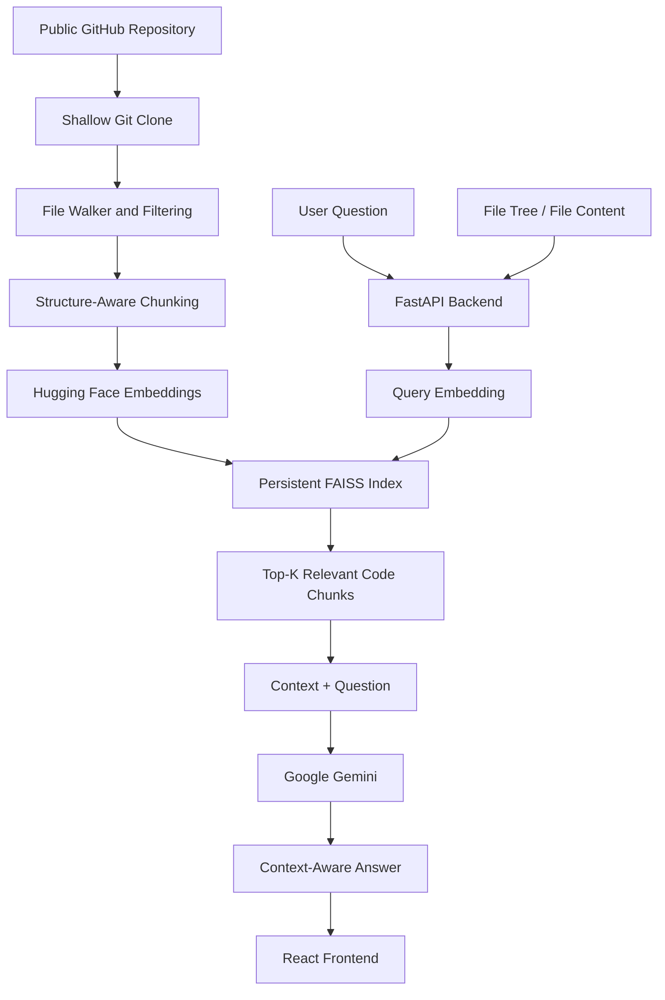

# CodeChat RAG (RepoGuide) 🚀

**Chat with any public GitHub repository using Retrieval-Augmented Generation (RAG).**

RepoGuide is an AI-powered codebase question-answering system that helps developers understand large GitHub repositories by asking questions in natural language. It ingests source code, splits files into meaningful chunks, indexes them using vector embeddings, retrieves relevant code snippets, and uses Google Gemini to generate context-aware answers.

Designed to work with repositories containing **50,000+ lines of code** while operating within a **512 MB RAM deployment constraint**.

## ✨ Features

- **GitHub Repository Ingestion:** Ingest public repositories using shallow Git clones.
- **Intelligent File Filtering:** Excludes binary files, non-source directories, and oversized files before processing.
- **Structure-Aware Chunking:** Splits source code into meaningful chunks to preserve useful programming context.
- **Semantic Code Search:** Uses Hugging Face embeddings and FAISS vector search to retrieve relevant code snippets.
- **AI-Powered Q&A:** Uses Google Gemini to answer questions grounded in retrieved repository context.
- **Per-Repository Indexing:** Maintains a persistent FAISS vector store for each ingested repository.
- **REST API:** FastAPI endpoints for repository ingestion, chat, file-tree exploration, and file-content retrieval.
- **Interactive Frontend:** React-based chat interface and file browser for exploring codebases.
- **Input Validation:** Pydantic schemas validate API requests and payloads.
- **Memory-Constrained Deployment:** Designed with resource-conscious ingestion and retrieval to operate within a 512 MB RAM environment.

## 🏗️ Architecture



### How It Works

**1. Repository ingestion**

The system shallow-clones a public GitHub repository to reduce unnecessary download overhead. An idempotent ingestion service and file walker process eligible source files while excluding binaries, irrelevant directories, and oversized files.

**2. Code chunking**

The source files are divided into smaller, structure-aware chunks. This helps preserve meaningful code context and makes retrieval more useful than treating an entire repository as one document.

**3. Embedding and indexing**

Hugging Face embedding models convert code chunks into vector representations. These vectors are stored in a persistent, repository-specific FAISS index.

**4. Semantic retrieval**

When a user asks a question, the system retrieves the top-K relevant code chunks using vector similarity search.

**5. Answer generation**

The retrieved snippets and user question are passed to Google Gemini as context. The model generates an answer based on the retrieved repository information, helping reduce unsupported or hallucinated responses.

**6. Frontend interaction**

The React frontend provides a chat interface and file browser. Users can ask questions, inspect the repository structure, and access file contents through the backend APIs.

## 🛠️ Tech Stack

| Component | Technology |
|---|---|
| Frontend | React |
| Backend API | FastAPI |
| RAG orchestration | LangChain |
| Embeddings | Hugging Face |
| Vector database/index | FAISS |
| LLM | Google Gemini |
| Repository ingestion | Git / shallow clone |
| Request validation | Pydantic |
| Data persistence | Per-repository FAISS indexes |

## 📂 Core Components

- **Ingestion Service:** Clones and processes public repositories, with idempotent ingestion behavior.
- **File Filtering Pipeline:** Selects eligible source files while excluding unnecessary content.
- **Chunking Pipeline:** Creates structure-aware chunks suitable for semantic retrieval.
- **Embedding Pipeline:** Converts chunks into vectors using Hugging Face embeddings.
- **Vector Retrieval:** Searches persistent FAISS indexes to identify relevant code.
- **Generation Pipeline:** Uses retrieved context and Gemini to answer user questions.
- **FastAPI Layer:** Exposes ingestion, chat, file-tree, and file-content functionality.
- **React Interface:** Combines conversational interaction with repository browsing.

## ⚙️ Getting Started

### Prerequisites

- Python 3.x
- Node.js and npm
- Git
- Google Gemini API key
- Access to a public GitHub repository

### 1. Clone the repository

```bash
git clone <YOUR_REPOSITORY_URL>
cd <YOUR_REPOSITORY_DIRECTORY>
```

### 2. Configure environment variables

Create the environment configuration file expected by your backend and add the Gemini API key.

```env
GEMINI_API_KEY=your_gemini_api_key
```

> Replace the variable name with the one actually used in your implementation. Add any other required configuration variables from your project.

### 3. Set up the backend

Navigate to the backend directory and create a virtual environment.

```bash
python -m venv venv
```

Activate it:

**Windows**
```bash
venv\Scripts\activate
```

**Linux / macOS**
```bash
source venv/bin/activate
```

Install the dependencies:

```bash
pip install -r requirements.txt
```

Start the FastAPI application using the entry point configured in your project. For example, if your application is exposed as `app` in `main.py`:

```bash
uvicorn main:app --reload
```

FastAPI's interactive API documentation is typically available at:

`http://127.0.0.1:8000/docs`

### 4. Set up the frontend

Navigate to the frontend directory:

```bash
cd frontend
npm install
npm run dev
```

Open the local URL printed by Vite in your terminal.

> **Note:** The directory names, entry-point module, dependency files, environment variable names, and API routes above are illustrative where not confirmed. Adjust them to match the actual repository structure.

## 🔌 API Capabilities

The backend provides functionality for:

| Capability | Purpose |
|---|---|
| Repository ingestion | Clone, process, and index a public repository |
| Chat | Retrieve relevant code and generate answers |
| File tree | Explore the repository's directory structure |
| File content | Retrieve the contents of a selected file |

Consult the FastAPI `/docs` interface for the actual endpoint paths, request schemas, and response formats.

## 🧠 Engineering Challenges

### 1. Handling large repositories

Processing large codebases can consume significant memory and computation. The ingestion pipeline filters unnecessary files before chunking and indexing to reduce avoidable processing overhead.

### 2. Improving retrieval quality

Generic text splitting can separate related code from its context. Structure-aware chunking helps create more meaningful retrieval units, while semantic top-K retrieval supplies relevant code to the generation model.

### 3. Making ingestion repeatable

An idempotent ingestion service helps avoid unnecessary repeated work when the same repository is processed again.

### 4. Supporting persistent indexes

Per-repository FAISS indexes allow the application to retain vector indexes between requests and avoid rebuilding them for every question.

### 5. Reducing unsupported answers

The RAG pipeline supplies retrieved code snippets as context to Gemini, helping ground answers in the repository instead of relying exclusively on the model's general knowledge.

### 6. Working within deployment constraints

The application was engineered around a 512 MB RAM deployment constraint, making careful file selection and resource-conscious processing important design considerations.

## 🚀 Future Improvements

- Support incremental indexing when repositories change.
- Add metadata filtering by file path, language, and directory.
- Improve retrieval through hybrid search and reranking.
- Add code-aware citations with file paths and line numbers.
- Support multi-repository workspaces.
- Introduce automated evaluation for retrieval relevance and answer correctness.
- Add ingestion progress tracking and caching.

## 🎯 Use Cases

- Understanding unfamiliar or large codebases.
- Finding where a function or feature is implemented.
- Exploring project architecture and module relationships.
- Investigating dependencies between files.
- Onboarding to open-source projects.
- Answering implementation-specific questions without manually searching every file.

## 👨‍💻 Author

**Madhav Dang**

B.Tech, Computer Science and Engineering  
Delhi Technological University (DTU)

- GitHub: [Your GitHub Profile](https://github.com/)
- LinkedIn: [Your LinkedIn Profile](https://www.linkedin.com/)

---

*RepoGuide demonstrates how repository ingestion, semantic vector retrieval, and large language models can be combined to make large codebases easier to explore and understand.*
